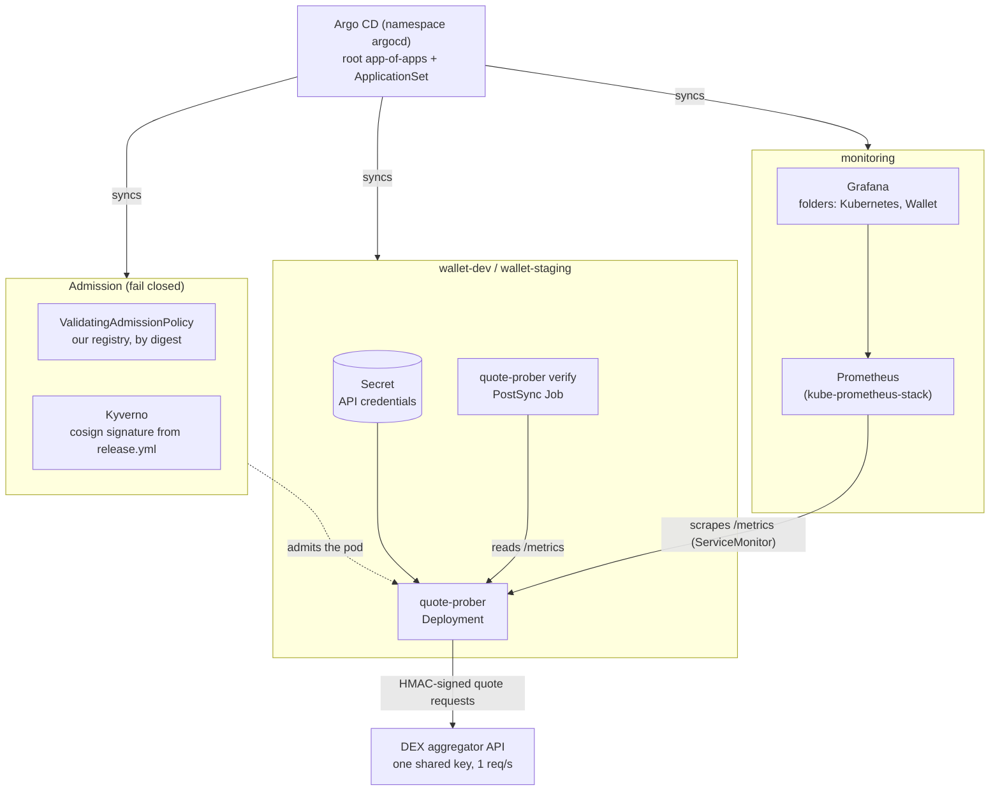
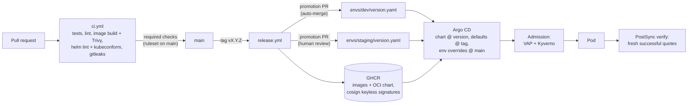

# wallet-k8s-practice

A platform practice lab for a self-custody DEX wallet backend: Go services, local Kubernetes (kind),
operators, Argo CD and GitHub Actions. See [PLAN.md](PLAN.md) for the full design and phases.

**Now (phase 0):** `quote-prober` probes a DEX aggregator's swap-quote API (Amber is the first
implementation) and exports Prometheus metrics; `mock-quote-api` fakes that API so everything runs
without credentials. CI runs from the first commit.

## Architecture

What runs in the cluster:



wallet-prod is set up the same way and gets an app once a release is promoted to it.

From a commit to a running pod:



## Quickstart

```bash
make hooks               # once per clone: pre-commit blocks secrets before they reach a commit
make run MOCK=1          # mock API + prober, no credentials needed
curl -s localhost:8080/metrics | grep '^swap_'
```

Against the real API (read-only quotes; nothing is signed or sent on chain):

```bash
cp .env.example .env     # fill in AMBER_ACCESS_ID and AMBER_HMAC_SECRET; .env is git-ignored
make run
```

On a local kind cluster (Prometheus Operator, Grafana dashboard, mock API by default):

```bash
make platform            # kind cluster "wallet-k8s-practice" + kube-prometheus-stack (~2 min)
make dev                 # inner loop: build, kind load, helm install mock + prober into wallet-local
make smoke               # asserts successful quotes are being recorded
make dev-down            # remove wallet-local again
make ui                  # Grafana on localhost:3300 (GRAFANA_PORT), folder Wallet, "Swap path — quote prober"
make dev REAL=1          # same, against the real API with the key from .env
make down                # delete the cluster
```

dev, staging and prod are deployed by Argo CD from git (pull-based: the cluster polls the repo, nothing
pushes into it), all from one ApplicationSet. dev and staging probe the real API; prod is defined but
not deployed yet. `make dev` uses its own namespace, wallet-local, which Argo CD does not manage.

```bash
make gitops              # Argo CD + root app-of-apps; follows your git remote (fork it for your own CD)
make argocd-ui           # Argo CD on localhost:8443, user admin
```

Argo CD also owns the platform: kube-prometheus-stack (auto-sync) and Argo CD itself (manual sync, no
prune). Change them through git; chart versions live in `deploy/argocd/values.yaml`. `make platform` /
`make argocd` are for a new cluster or break-glass only; commit any fix made that way right after.

A workload Application exists for `<env>` only once `deploy/envs/<env>/version.yaml` names a release;
prod is never auto-synced. A release reaches an environment only through a pull request (dev merges
itself once CI passes, staging needs review); in the cluster, admission policies admit only images from
this repo's registry, pinned by digest and signed by its release workflow (Kyverno + a built-in
ValidatingAdmissionPolicy, `deploy/policies`), and a PostSync Job checks that the new release gets
quotes. Details: [guardrails](docs/environments-and-promotion.md#guardrails-between-git-and-a-running-pod).

`make help` lists every target. `make ci` runs locally what the CI workflow runs. `make render` writes
the final manifests of every environment to `build/rendered/`. Environments, versions and promotion:
[docs/environments-and-promotion.md](docs/environments-and-promotion.md).

## Layout

```
apps/go/
  cmd/quote-prober/        wiring and lifecycle; `quote-prober verify` is the post-deploy check
  cmd/mock-quote-api/      fake API: verifies signed headers, rejects replayed nonces; MOCK_MODE degrades the
                           quote endpoints (rate_limited, server_error, slow + MOCK_SLOW_DELAY)
  internal/aggregator/     vendor-neutral Quoter interface and types
  internal/aggregator/amber/        Amber client (go-libs HTTP client, rate limiter, error mapping)
  internal/aggregator/amber/sign/   HMAC-SHA256 request signing (pure, tested against openssl vectors)
  internal/aggregator/amber/fixtures/  response bodies shaped like the API docs
  internal/probe/          scheduler (staggered scenarios) and metrics
  internal/config/         env + scenarios.yaml, validated at startup
  internal/httpserver/     /metrics, /healthz, /readyz, graceful shutdown
  scenarios.yaml           what to probe
.github/workflows/ci.yml   tidy, vet, race tests, golangci-lint, image build + Trivy, helm lint + kubeconform,
                           gitleaks, Trivy fs
deploy/bootstrap/          kind cluster (node image pinned by digest)
deploy/platform-values/    kube-prometheus-stack, Argo CD and Kyverno values
deploy/policies/           admission policies for wallet-dev/staging/prod (Helm chart, Argo CD app "policies")
deploy/charts/go-service/  one chart for both Go binaries: Deployment (restricted PSS), Service,
                           ServiceMonitor, scenarios ConfigMap; strict values schema
deploy/dashboards/         Grafana dashboard (folder Wallet), installed once into monitoring; "environment" picks the namespace
deploy/apps/               per-app defaults shared by every environment
deploy/envs/{dev,staging,prod}/  namespace, version.yaml and thin per-app overrides
hack/                      secret.sh (never prints values), smoke.sh, render.sh, check-env-values.py
```

## Metrics

| Metric | Labels | Meaning |
|---|---|---|
| `swap_probe_total` | aggregator, scenario, step, result | attempts; `result` is ok, http_4xx, http_429, http_5xx, client_throttled, timeout, decode_error, no_route, unsupported, error |
| `swap_probe_duration_seconds` | aggregator, scenario, step | latency, including the client rate-limit wait |
| `swap_probe_last_success_timestamp_seconds` | aggregator, scenario | for "probe stale" alerts |
| `swap_quote_winner_total` | aggregator, scenario, provider | which liquidity provider wins |
| `swap_quote_routes` | aggregator, scenario | routes offered |
| `swap_quote_amount_out` | aggregator, scenario | expected output, smallest units |
| `swap_quote_price_impact_ratio` | aggregator, scenario | USD out / USD in - 1, fees included; -0.007 = 0.7% lost |
| `httpclient_request_total`, `httpclient_request_duration_seconds` | aggregator, url, method, name, status | from the go-libs HTTP client |

## Dashboard

"Swap path — quote prober", one environment at a time, read top to bottom:

| Row | Answers |
|---|---|
| Service level | Is the quote path meeting its SLOs? Availability and latency (under 2s) SLIs, error budget left, burn rate over 1h and 6h. 24h window: the lab Prometheus keeps 2 days |
| Probe health | Success per scenario, time since the last good quote, results, p95 per step |
| Upstream API | Is the aggregator the cause? HTTP-only latency and status per endpoint, time spent waiting in the client rate limiter, and how much of the key's 1 request/s all environments use together |
| Swap quality | What a user would be quoted: winning provider, routes, amount out, price impact |

Grafana folders separate ownership: **Kubernetes** holds the dashboards that ship with
kube-prometheus-stack (upgraded with the chart, never edited); **Wallet** holds the service dashboards
from this repo. The dashboard links to "Kubernetes / Compute Resources / Namespace (Pods)" for the same
namespace. Both are provisioned from ConfigMaps; the UI cannot save them; change the JSON in git.

## Configuration

| Variable | Default | Notes |
|---|---|---|
| `AMBER_ACCESS_ID`, `AMBER_HMAC_SECRET` | — | required; from the environment only |
| `AMBER_BASE_URL` | `https://tws.trustwallet.com` | |
| `AMBER_RPS` | `0.5` | must be ≤ 1 (free tier limit) |
| `PROBE_INTERVAL` / `PROBE_TIMEOUT` | `60s` / `10s` | timeout must be shorter than the interval |
| `SCENARIOS_FILE` | `scenarios.yaml` | |
| `LISTEN_ADDR` | `:8080` | |

## Notes

- `github.com/sirupsen/logrus` is required at v1.9.3 although go-libs pins v1.8.1: v1.8.1 has
  CVE-2025-65637 (HIGH), found by the Trivy step in CI.
- The API docs' example date "Thu, 27 Feb 2026" is a Friday; the signer tests use the correct weekday
  and vectors computed independently with `openssl dgst -sha256 -hmac`.
- `.gitleaks.toml` allows public EVM addresses (0x + 40 hex), which the generic API-key rule flags.
